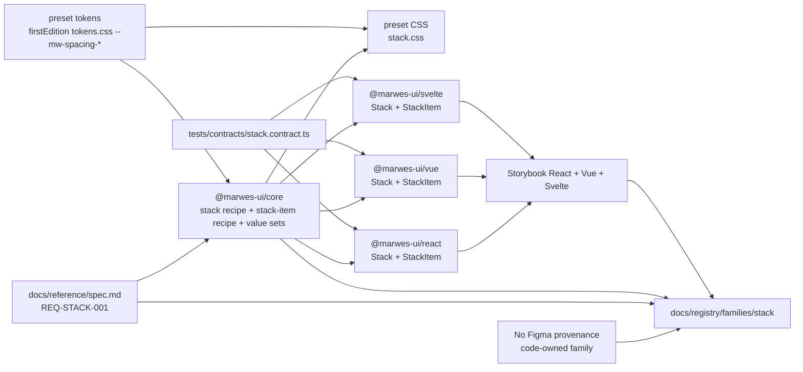
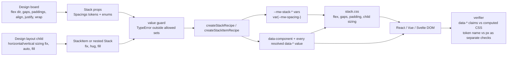

# Stack Registry

> Family: `stack`
>
> Local design refs only — this page uses the synced files under `.figma/` and makes no
> Figma API calls.

## Registry files

- [`registry.meta.json`](./registry.meta.json)
- [`registry.generated.json`](./registry.generated.json)
- [`../../../../artifacts/component-registry.json`](../../../../artifacts/component-registry.json)

## Registry snapshot

| Field | Value |
| --- | --- |
| Family status | In progress |
| Audit status | In progress — `docs/audits/stack-family-accessibility.md` exists; owner sign-off pending |
| Semantic coverage | Family-local — Stack emits `data-component="stack"` / `"stack-item"` and every resolved layout value from core, but it is not part of the wave-1 central semantic registry |
| Generated structural truth | `registry.generated.json` + `artifacts/component-registry.json` |
| Primary Figma nodes | none — Stack is code-owned with no Figma provenance (spacing precedent) |
| Reflection | no `reflection-contract.json` and no baselines, so `cohesive-check` and `governance:status` skip this family |
| Main AXE watch item | landmark naming when `as` renders a landmark, and `ul`/`ol` stacks containing only `StackItem as="li"` |

## Registry ownership

- `README.md` is the human teaching page.
- `registry.meta.json` is the authored structured summary for this family.
- `registry.generated.json` and `artifacts/component-registry.json` are generator-owned structural outputs.
- the family uses local layout metadata in core and is not part of the central wave-1 semantic registry.
- `visuals/*.mmd` help people orient themselves quickly, but they are not the canonical implementation source.

## Summary

Stack is Marwes' one layout primitive. It exists so a page can express design auto layout through a
single component and be compared with the design one value at a time.

It consists of:
- one `Stack` flex container (a design board) with direction, gap, padding, alignment, justification, wrap and `as`
- one `StackItem` declared child (a design layout child) with horizontal and vertical sizing `fix | hug | fill`
- core `createStackRecipe` and `createStackItemRecipe`, plus exported value sets for every enum
- one preset `stack.css` whose selectors are all rooted in `.mw-stack` or `.mw-stack-item`
- thin React, Vue and Svelte adapters proven equal by `tests/contracts/stack.contract.ts`

Gap and padding accept only `Spacings` tokens. There is no scale, calc, px or width/height prop, and
any token, enum value or `as` outside the allowed sets throws a `TypeError` (the Icon recipe already
throws for an unknown icon).

## Canonical visual understanding

Read this section in this order:
1. canonical Storybook story references for runtime visuals
2. the layer map for repo placement
3. the interaction map for how declared values become CSS and verifiable data attributes

## Primary visual sources

| Source | Path | Why it matters |
| --- | --- | --- |
| React Storybook | `apps/storybook-react/src/stories/stack/Introduction.mdx` | Penpot mapping table and verifier rules |
| React Storybook | `apps/storybook-react/src/stories/stack/stack.stories.tsx` | Default, Directions, Gap, Padding, Alignment, Justify, Wrap, ChildSizing and Nested |
| React Storybook | `apps/storybook-react/src/stories/stack/stack-item.stories.tsx` | StackItem sizing and `ul`/`li` list items |
| Vue Storybook | `apps/storybook-vue/src/stories/stack/` | the same stories in Vue |
| Svelte Storybook | `apps/storybook-svelte/src/stories/stack/` | the same stories in Svelte through `StackShowcase.svelte` |

> Minimum visual reading set for this family: the Storybook Introduction and the ChildSizing and Nested stories in any framework.

## Figma references

Primary synced refs inspected:
- `.figma/INDEX.md`
- `.figma/marwes/README.md`
- `.figma/marwes/manifest.json`
- `.figma/marwes/components/_index.json`
- `.figma/NODE_REFERENCE.md`
- `.figma/nodes.json`

Stack-specific result: there is no stack component JSON, page, node row or token section. The
registry entry therefore has empty `componentJsons`, `pageReferences`, `nodeReferences` and
`figmaTokens`, and only the generic curated `.figma` refs. design-governance
`validate --family stack` passes only on framework surfaces and vacuous Figma checks; that is a
statement about provenance, not proof of design parity.

## Figma variant summary

| Surface | Variants | States | Notable tokens |
| --- | --- | --- | --- |
| Local synced Figma family refs | none | none | no dedicated stack family exists in the local sync |
| Shipped runtime layout surface | direction `row`/`column`, alignItems 4 values, justifyContent 6 values, wrap 2 values, sizing `fix`/`hug`/`fill`, 9 Stack `as` and 2 StackItem `as` values | defaults column / start / start / nowrap / hug / hug, `sp-0` | gap and padding resolve to `var(--mw-spacing-<token>)` from `tokens.css` |

## Visual model

### Layer map



Source copy: [`visuals/layer-map.mmd`](./visuals/layer-map.mmd)

### File map

```mermaid
flowchart TD
  Registry["docs/registry/families/stack"]
  Registry --> Meta["registry.meta.json"]
  Registry --> Generated["registry.generated.json"]
  Registry --> Visuals["visuals/*.mmd"]

  Core["packages/core/src/components/atoms/stack/"]
  Core --> CoreFiles["stack.recipe.ts stack-item.recipe.ts stack.types.ts stack.values.ts"]

  Presets["packages/presets/src/firstEdition/"]
  Presets --> StackCss["stack.css"]
  Presets --> TokensCss["tokens.css"]

  React["packages/react/src/components/stack/"]
  React --> ReactFiles["stack.tsx stack-item.tsx index.ts"]

  Vue["packages/vue/src/components/stack/"]
  Vue --> VueFiles["stack.ts stack-item.ts index.ts"]

  Svelte["packages/svelte/src/lib/components/stack/"]
  Svelte --> SvelteFiles["Stack.svelte StackItem.svelte types.ts index.ts"]

  Contract["tests/contracts/stack.contract.ts"]
  StoriesR["apps/storybook-react/src/stories/stack/"]
  StoriesV["apps/storybook-vue/src/stories/stack/"]
  StoriesS["apps/storybook-svelte/src/stories/stack/"]
  Audit["docs/audits/stack-family-accessibility.md"]
```



Source copy: [`visuals/file-map.mmd`](./visuals/file-map.mmd)

### Interaction and semantics map



Source copy: [`visuals/interaction-map.mmd`](./visuals/interaction-map.mmd)

## Penpot mapping

| Penpot | Stack prop | Data attribute | CSS |
| --- | --- | --- | --- |
| `flex.dir` row / column | `direction` | `data-direction` | `flex-direction` |
| `flex.rowGap` | `rowGap` (or `gap`) | `data-row-gap` | `row-gap: var(--mw-stack-row-gap)` |
| `flex.columnGap` | `columnGap` (or `gap`) | `data-column-gap` | `column-gap: var(--mw-stack-column-gap)` |
| `flex.topPadding` … `leftPadding` | `paddingTop` … `paddingLeft` (or `paddingY` / `paddingX` / `padding`) | `data-padding-*` | `padding` from `var(--mw-stack-padding-*)` |
| `flex.alignItems` | `alignItems` (default `start`) | `data-align-items` | `flex-start` / `center` / `flex-end`; Penpot stretch is child `fill`, rule (g) |
| `flex.justifyContent` | `justifyContent` | `data-justify-content` | `flex-start` / `center` / `flex-end` / `space-*` |
| `flex.wrap` | `wrap` | `data-wrap` | `flex-wrap` |
| `layoutChild.horizontalSizing` fix / auto / fill | `horizontalSizing` fix / hug / fill | `data-horizontal-sizing` | main axis `flex: 1 1 0` or `0 0 auto`; cross axis `align-self: stretch` or `auto` + `fit-content` |
| `layoutChild.verticalSizing` fix / auto / fill | `verticalSizing` fix / hug / fill | `data-vertical-sizing` | as above |

Unsupported for now: Penpot `row-reverse`, `column-reverse`, justify `stretch`, `alignSelf`,
`alignContent`, min/max sizes, margins and absolute positioning.

## Verifier rules

- **(a) data-* attributes are claims.** Computed CSS must equal the CSS mapping of each attribute:
  flex-direction, align-items, justify-content, flex-wrap, row/column gap, the four paddings and each
  child's flex and align-self. Any divergence fails. Only the `--mw-stack-*` vars are structurally
  protected (kit vars merged last); consumer style or className overrides of other keys are caught
  by this rule rather than stripped.
- **(b) Token and px are separate checks.** The design-bound token is compared with the `data-*`
  token name, and the design px with the computed px, because a theme can redefine `--mw-spacing-*`.
- **(c) Only StackItem or Stack children are governed.** Undeclared direct children of a governed
  Stack fail verification.
- **(d) Sizing has no effect outside a Stack parent** and is ignored there.
- **(e) `fix` is declared-only.** It renders like `hug`; a design fix size that differs from the DOM
  rect beyond tolerance is a design decision, never accepted as hug.
- **(f) No sp-6.** It has no code token and is never mapped to the nearest token silently.
- **(g) Penpot stretch is child fill.** `alignItems` has no `stretch`. A Penpot board with
  `alignItems` stretch is verified as cross-axis `fill` on every child (`verticalSizing` in a row,
  `horizontalSizing` in a column) with the parent at `start` or another explicit value. A Penpot
  child that is not fill under a stretch board is a design mismatch, never accepted. This keeps
  one declared value per rendered size: a hug or fix child never renders stretched (DEC-022).

## Philosophy

- **One primitive, one-to-one mapping.** A design board is one Stack; a layout child is one StackItem or nested Stack.
- **Tokens only.** Gap and padding accept only `Spacings`; anything else throws.
- **Claims, not proof.** Data attributes declare intent; a verifier confirms them against computed CSS.
- **Honest provenance.** Stack is code-owned, family-local and has no Figma provenance or reflection baselines.

## AXE / accessibility posture

| Area | Status | Notes |
| --- | --- | --- |
| Risk tier | Low | presentational container with no role of its own |
| Audit status | In progress | `docs/audits/stack-family-accessibility.md`; owner sign-off pending |
| Automated contract | Strong | core, preset CSS and shared adapter contracts plus Storybook a11y smoke |
| Manual review boundary | Narrow | landmark naming via `as`, list structure, and layout verification against computed CSS |

### What automation already covers

- core recipe defaults, precedence, every enum value and the `TypeError` guard
- preset CSS mapping, child sizing for both parent directions and selector scoping
- the shared contract in React, Vue and Svelte, including passthrough attributes, recipe-owned `data-component`, `ul`/`li` lists and nested sizing
- Storybook taxonomy, introduction-docs and a11y smoke runs in all three Storybooks

### What still needs manual review or policy clarity

- an `aria-label` when a page has more than one `nav`, `aside` or other landmark of the same kind
- `as="ul"` or `as="ol"` stacks must contain `StackItem as="li"` children
- layout parity against the design is verified outside Marwes by the rules above

### Production error behaviour

Invalid tokens, enum values and `as` throw in dev and test in all three adapters. In production,
React unmounts to the nearest error boundary, Svelte aborts the mount, and Vue routes the error
through `handleError` and logs it with `console.error`.

### Current implementation hotspots

- `packages/core/src/components/atoms/stack/stack.recipe.ts` resolves precedence, guards values and emits vars and data attributes.
- `packages/core/src/components/atoms/stack/stack.values.ts` owns the allowed value sets and the guard.
- `packages/presets/src/firstEdition/stack.css` maps every data attribute to CSS.

## Semantics snapshot

| Field | Current stack family contract |
| --- | --- |
| `data-component` | `stack`, `stack-item` |
| canonical attributes | not part of the wave-1 central semantic registry |
| purpose vocabulary | n/a |
| source of truth | `packages/core/src/components/atoms/stack/` and `packages/presets/src/firstEdition/stack.css` |

## Linked files

| Layer | Path | Why it matters |
| --- | --- | --- |
| Spec | `docs/reference/spec.md` | REQ-STACK-001, open decisions and decision log |
| Audit | `docs/audits/stack-family-accessibility.md` | in-progress family audit |
| Core | `packages/core/src/components/atoms/stack/stack.types.ts` | unions and option types |
| Core | `packages/core/src/components/atoms/stack/stack.values.ts` | value sets and the guard |
| Core | `packages/core/src/components/atoms/stack/stack.recipe.ts` | Stack render kit |
| Core | `packages/core/src/components/atoms/stack/stack-item.recipe.ts` | StackItem render kit |
| Presets | `packages/presets/src/firstEdition/stack.css` | layout CSS |
| Presets | `packages/presets/src/firstEdition/tokens.css` | `--mw-spacing-*` values |
| React | `packages/react/src/components/stack/` | React adapter |
| Vue | `packages/vue/src/components/stack/` | Vue adapter |
| Svelte | `packages/svelte/src/lib/components/stack/` | Svelte adapter |
| Contract | `tests/contracts/stack.contract.ts` | shared cross-adapter contract |
| Stories | `apps/storybook-react/src/stories/stack/`, `apps/storybook-vue/src/stories/stack/`, `apps/storybook-svelte/src/stories/stack/` | teaching and visual surface |

## Adapter parity expectations

- React, Vue and Svelte render the same tag, class, data attributes and `--mw-stack-*` vars for the same options.
- Attribute order is consumer attributes, then recipe data attributes, then class, then style, so consumers cannot override `data-component`.
- Kit vars are merged after the consumer style in every adapter. Vue uses `[attrs.style, kit.vars]`; the shared `mergeStyles` helper is unchanged.

## Verification

```bash
pnpm --filter @marwes-ui/core exec vitest run test/recipes/stack.test.ts
pnpm --filter @marwes-ui/presets exec vitest run test/stack-css-contract.test.ts
pnpm --filter @marwes-ui/react exec vitest run src/components/stack
pnpm --filter @marwes-ui/vue exec vitest run src/components/stack
pnpm --filter @marwes-ui/svelte exec vitest run src/tests/shared-contracts.test.ts -t "Stack contract"
pnpm validate:family stack --storybook
pnpm --filter @marwes-ui/design-governance validate -- --family stack
```

## Registry notes

- the family source map is maintained in `scripts/component-registry-sources.ts`
- the family has no reflection contract or baselines; visual evidence comes from Storybook and computed-style checks
- spacing's stale metadata and alias gap are intentionally not touched by this family

## Open questions

- sp-6 is bound in the design Spacings but has no `--mw-spacing-sp-6` token. Add it as a separate token decision, or move consumer designs to sp-4 or sp-8?
- Add `row-reverse` and `column-reverse` once Penpot's justify start/end rendering on reverse boards is verified?
- Emit `fix` (current) or `fixed`, which some collectors normalise to?
- Are alignSelf, min/max sizes, margins, absolute positioning or alignContent needed now?
- Mark the family shipped on merge (spacing precedent) or keep it in progress until release?
